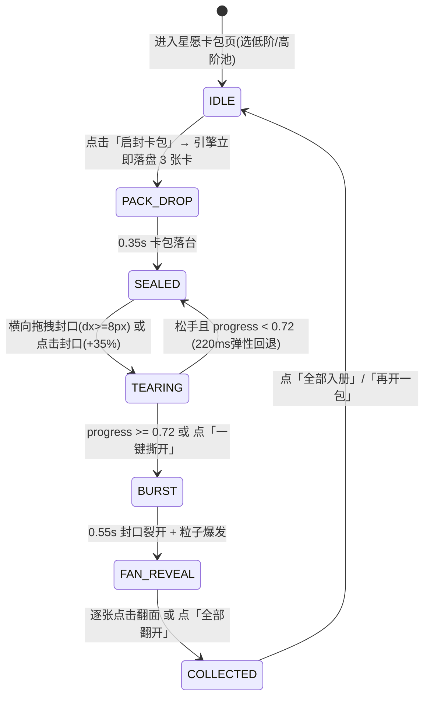

# 《神豪终端》rc.37 实施方案：星愿卡包抽卡 + 三页重做 + 使用通道 + 前端消缺

> **版本目标**：`2.0.0-rc.37` · `cardContractRevision: 31 → 32`
> **工作区**：`E:\SHZDCHOSSS`
> **执行纪律**：DSH 按本方案施工；**`## H 文案定稿` 代码块内所有玩家可见文案必须由脚本逐字抠取写入 `src/core/wheel-ui-copy.js`，严禁任何手工改写、缩写或润色。**

---

## 0 可行性核验

### 0.1 实机运行环境基线（已逐项核对）

| 核验项 | 实测结果 | 依据 |
|---|---|---|
| SillyTavern 本体 | `1.19.0`（8001 实例运行中） | `E:\Ajiuguanagentceshi\SillyTavern\package.json` |
| 第三方扩展 | `Engram`、`JS-Slash-Runner`（v`4.12.0`）、`LittleWhiteBox`、`ST-Prompt-Template` | `E:\Ajiuguanagentceshi\SillyTavern\public\scripts\extensions\third-party\JS-Slash-Runner\manifest.json` |
| 助手 API 兼容性 | `host.js:14–15` 依赖的 10 个 API（`getChatMessages / createChatMessages / getVariables / generateRaw / stopGenerationById / triggerSlash / getCharWorldbookNames / getWorldbook / getTavernVersion / getTavernHelperVersion`）在 `JS-Slash-Runner@4.12.0` 的 `.d.ts` 中全部存在、签名未变 | `JS-Slash-Runner` 目录下 `index.d.ts`、`chat_message.d.ts`、`variables.d.ts`、`generate.d.ts`、`version.d.ts` |
| 变量与 MVU 边界 | `window.parent.Mvu` 由卡内 `src/runtime/mvu-loader.js:1–12` 加载上游 MagVarUpdate 提供；`window.parent.__CJ_SHENGHAO_SCHEMA__` 由 `schema-entry.js` 挂载。UI 在独立 iframe 内只读快照、通过 `api.action` / `WHEEL_OP_REQ` 提交命令，**不碰 MVU 加载器**；但新增状态字段必须同步改 `src/runtime/schema.js` 并升 `cardContractRevision` 至 `32` | `src/runtime/mvu-loader.js:1–12`、`src/runtime/host.js:65–70, 225–238` |
| Sandbox 约束 | 小手机与全屏轮盘均为 `sandbox="allow-scripts allow-same-origin"`，**无 `allow-modals` / `allow-forms` / `allow-popups`**。本方案零使用 `alert/confirm/prompt`、零原生 `<form submit>`、零 `window.open` | `src/runtime/host.js:328, 355` |
| 性能与卡顿红线 | 禁用 `backdrop-filter`、禁用 SVG `filter`/`drop-shadow`、禁用常驻多环旋转与逐帧读布局；沿用 rc.36 通过基线：**全屏 SVG ≤ 250 节点**（实测 244 节点通过）、粒子 1.6s 硬停帧、`contain: layout paint` | `reports/rc36-施工记录-20261120.md:39–40`、`HANDOFF.md:26–27` |
| 量测与零 API 验收 | 离线仿真：`.work/harness/host.html` + `window.harness.measure()`；真机 8001：`scripts/test-noapi-seed.mjs` + `scripts/test-noapi-run.mjs`（5/5 预置 PASS、`apiCalls: 0`） | `reports/零API测试记录-20261120.md:29–42` |

### 0.2 效果可行性矩阵

| 效果 | 挂在哪个渲染面 | 依赖的运行时能力 | 判定 | 依据 | 降级版 |
|---|---|---|---|---|---|
| 卡包撕开手势（横向拖拽撕裂 + 点击兜底） | 全屏轮盘 iframe（`#cj-shenghao-wheel-frame`） | Pointer Events（`setPointerCapture`）、`touch-action: none`、`lockTopScroll(true)` | **可行** | `host.js:346–358` 全屏 iframe 独立于小手机 scale 且锁定宿主 `body.overflow='hidden'`，无聊天页滚动竞争；`app.js:229` 已验证 Pointer Capture 在酒馆 iframe 可用 | 无需降级；内置「点击/一键撕开」双通道保障纯鼠标与无障碍 |
| 一包 3 卡扇形展开与翻面揭晓 | 全屏轮盘 iframe | CSS `transform: translate3d() rotate()` + `transition`（3 个元素） | **可行** | 仅 3 个合成层、无 3D `preserve-3d` 嵌套滤镜、无布局重排；符合 `wheel.css:5` `contain: layout paint` 约束 | 无需降级（`prefers-reduced-motion: reduce` 下直接淡入无位移） |
| 卡面稀有度光效（扫光 + 爆发） | 全屏轮盘 iframe & 小手机收藏册 | CSS 伪元素一次性 `translateX` 扫光 + 现有 `#wfFx` 1.6s Canvas 粒子 | **降级可行** | `reports/rc36-施工记录-20261120.md:40` 实测 `backdrop-filter` 与常驻重绘触发 `PageUnresponsive`；`wheel-frame.js:156–191` 实测 1.6s 停帧粒子零卡顿 | **按降级版施工**：揭晓翻面仅播 1 次 `1.2s` CSS 伪元素斜向扫光（播完停帧）；收藏册/背包内**零常驻动画、零 `filter`、零 `box-shadow` 呼吸** |
| 静态金属质感（镀边、暗纹、角饰、12 款纹样） | 全屏轮盘 iframe & 小手机 iframe | CSS 多重 `linear-gradient` + 内联极简 SVG `<symbol>/<use>` | **可行** | `wheel-frame.js:53–59` 已实测 `<symbol>/<use>` 244 节点流畅；单张卡面 SVG ≤ 12 节点，3 张卡共 ≤ 36 节点 | 无需降级 |
| 收藏册网格（卡册 / 稀有度排序 / 锁定） | 小手机 iframe（悬浮 & 正文底部宽屏） | CSS Grid + 现有 `modalOverlay` 弹窗 | **可行** | `style.css:146, 309–314` 已在悬浮 365px 与底部宽屏下跑通多列网格；弹窗内独立 `overflow: auto` | 无需降级 |
| 商城与背包分类切换 | 小手机 iframe | 内存态 Tab 变量 + 局部重绘 + `syncBottomHeight()` | **可行** | 与财富页 `assetTab`（`app.js:260`、`screens.js:119`）完全同构 | 无需降级 |
| 轮盘落点高亮（任意环、连抽 50 次对齐） | 全屏轮盘 iframe | 每环内建 `.hit-wedge` + 累计角同余归一 | **可行** | 把 `.hit-wedge` 迁入各 `<g class="ring">` 局部坐标系，仅增 2 个 SVG 节点（244 → 246），数学上零漂移 | 无需降级 |
| 结果弹出的卡牌出场 | 全屏轮盘 iframe | `#wfResult` 升级为居中舞台弹层（`opacity + transform`） | **可行** | `wheel.css:43–53` 现有弹层机制，零 `backdrop-filter` | 无需降级 |
| 底部停靠下的折叠条（无滚动条） | 正文底部 `.mes_text` | `host.js:436–439` 精确高度 `56px` + `body.is-folded-bar` 锁 `overflow: hidden` | **可行** | 现行 `host.js:439` 硬写 `52px` 且 `app.js:204` 未清 `is-bottom-dock`；对齐 `56px = 52 + 2×2` 后零溢出 | 无需降级 |
| 外部远程卡图（图床插画作卡面） | 全屏轮盘 & 小手机 | 外部 HTTPS 图床加载 | **不可行** | 无卡面图库资产、离线/弱网首屏白块、增加跨域与维护成本 | **本轮禁用外部图**，100% 纯 CSS 金属材质 + 12 款内联矢量纹样 |

### 0.3 不可行清单与降级结论

1. **不可行（已剔除）**：外部图片卡面、`backdrop-filter` 毛玻璃底罩、SVG `<filter>`/`feGaussianBlur`/`drop-shadow` 发光、常驻无限循环的金属流光动画。
2. **降级结论（正文直接按此规格写死）**：所有卡面光效统一采用**「静态双层渐变金属框 + 揭晓时一次性 1.2s 斜向扫光 + 1.6s 停帧粒子」**；收藏册与背包内全静态零常驻动画。

---

## A 缺陷清单

| 级别 | 编号 | 现象 | 根因 | 文件:行 |
|---|---|---|---|---|
| **P0** | D1 | 命运轮盘黄色落点高亮在中环/内环对不准，只有最外环对得整齐，且越抽越歪 | `animate()` 对全部 3 个 `.ring`（`data-ring="0/1/2"`）写了 `transform: rotate(...)`，但 `done()` 仅复位 `[data-ring="0"]`；中/内环永久残留旋转角，而 `.hit-wedge` 挂在 `<svg>` 顶层不随环旋转，导致坐标彻底错位 | `src/ui/wheel-frame.js:97, 259–274, 289–297, 313–320` |
| **P0** | D2 | 抽完一次后黄块不消失；再点抽一次轮盘转动期间，旧黄块仍停在盘面上，直到本次落定才替换 | `spinPlay` / `spinWish` / `spinCasino` 开转前只调用 `hideResult()`，漏掉 `clearHit()`；`clearHit()` 仅在切盘和重建盘面时被调用 | `src/ui/wheel-frame.js:417–503, 523, 577` |
| **P0** | D3 | 星愿盘动画落点与高亮扇区指向不同格子（如红色停在 6 号格、高亮亮在 8 号格） | 动画用 `WISH_ORDER.indexOf(rarity)`，高亮用 `WISH_ORDER.lastIndexOf(rarity)`，同稀有度多格必然错位 | `src/ui/wheel-frame.js:277` vs `:326` |
| **P1** | D4 | 固定在正文底部模式时，点右上角折叠后，折叠状态栏右侧出现上下滚动条 | `app.js:206` 传 `height:56`，`host.js:436–439` 对 `height<=120` 强行截成 `52px`；同时 `app.js:203–208` 折叠提前返回未移除 `body.is-bottom-dock`（`style.css:282` 设了 `overflow:visible!important`），`.folded-bar`（48+4 margin）被字体/边框撑超 52px 即出滚动条 | `src/runtime/host.js:436–439`、`src/ui/app.js:203–208`、`src/ui/style.css:139, 273, 282` |
| **P1** | D5 | 背包内玩法券与奇物只有纯展示文字，没有使用按钮、没有使用通道 | `bagModal()` 仅给 `WISH_CARD` 渲染了按钮，`WHEEL_PRIZE` 与 `SURREAL_ITEM` 无任何动作按钮；数据层 `appointment.sourceItemId` 与 `syncWheelInventory` 已存在但前端与引擎未接通 | `src/ui/app.js:52–70`、`src/runtime/schema.js:31`、`src/runtime/settlement.js:115–125` |
| **P2** | D6 | 轮盘页信息冗长、一页两层标题（「轮盘」+「命运与星愿」），打开背包/商城时背后双标题仍透出 | 顶栏已显示「轮盘」，`wheelHub()` 又渲染 `.section-head`「命运与星愿」，入口卡堆砌 4 行文案；弹窗遮罩透明度过低 | `src/ui/app.js:214`、`src/ui/screens.js:121–135` |
| **P2** | D7 | 商城（30 条混排）与背包（三类混排）无分类，下滑到底耗时过长 | `shopModal()` 将 14 异能与 16 奇物拼成单列；`bagModal()` 无 Tab 分栏 | `src/ui/app.js:52–85` |
| **P2** | D8 | 背包与通用弹窗右上角关闭叉号 `×` 未居中，视觉偏下偏右 | `.modal-close` 未设 `display:inline-flex; align-items:center; justify-content:center; padding:0`，裸字体行高偏移 | `src/ui/style.css:146` |

---

## B 卡包抽卡与收藏

### B.1 卡包结构（拍板决策）

- **形态变更**：星愿圣盘从「12 格单环转盘出 1 条字」升级为**「星愿卡包启封台」**。全屏轮盘顶部三模式标签更新为：`✦ 命运轮盘` / `✧ 星愿卡包` / `❖ 暗夜赌场`。
- **一包几张**：**固定 1 包 3 张星愿卡**（左常规位 + 中常规位 + 右**压轴保底位**），**允许包内重复**。
- **取舍理由**：
  - 相比 1 包 1 张：3 张卡可做扇形展开 + 第 3 张压轴悬念，开包仪式感远强于单卡弹出；
  - 相比 1 包 5 张：3 张在 375px 窄屏一排刚好放得下（`3×102px + 2×10px = 326px`），且单卡积分不会被稀释到个位数；
  - 允许包内重复：天然配合「收藏一张、拿重复的去赌场搏翻倍」的心理循环。
- **经济影响**：高阶「圣典卡包」3 张合计期望积分 `147.6 分`，与原单抽 49.2 × 3 保持同量级且严格受每日 2 包 / 每周付费 5 包限制；低阶「星尘卡包」采用独立小面额（10/30 分）与赌场 240 分硬封顶，见 C 节演算。

### B.2 撕开交互状态机



**交互工程铁律**：
1. **先落盘、后揭晓**：点击「启封卡包」即发送 `PLAYER_PACK_DRAW`，本地确定性引擎**当场扣费、推进保底、生成 3 张卡写入 `state.inventory`** 并返回 3 张卡数据；随后的撕开与翻面纯属前端仪式。中途断线/刷新/强关浮层绝不吞钱、绝不丢卡，也无法借刷新 SL。
2. **双触发通道**：
   - **拖拽撕裂**：封口区域绑定 `pointerdown` + `setPointerCapture` + `pointermove`，样式加 `touch-action: none`；进度 `progress = clamp((clientX - startX) / (packWidth * 0.72), 0, 1)`，封口虚线与上盖随 `progress` 实时 `translateX/rotate` 掀开。
   - **点按兜底**：水平位移 `< 8px` 且按下 `< 260ms` 视为点击，单次点击推近 `35%` 撕裂进度（连点 3 次撕开）；卡包下方常驻次按钮 **`一键撕开`**，点击直达 `100%`。
3. **移动端点按与拖拽区分**：`pointerdown` 记录 `(startX, startY, t0)`，首次移动达到 `8px` 时判断 `|dx| >= |dy|` 才进入 `TEARING`；竖向滑动不触发撕裂，且全屏层已 `lockTopScroll(true)`，不会带跑宿主聊天页。
4. **依次揭晓**：`FAN_REVEAL` 时 3 张卡以 `-10° / 0° / +10°` 扇形卡背展开（高阶金/虹卡背边缘提前透出微弱金/紫描边制造期待感）。玩家可逐张点击翻面，也可点底部 **`全部翻开`**（按 `0ms / 180ms / 360ms` 错峰翻开，第 3 张压轴最后亮出）。
5. **中途关闭处理**：`PACK_DROP`（0.35s）与 `BURST`（0.55s）期间锁定关闭；`SEALED / FAN_REVEAL` 阶段允许点 `×` 或按 `Esc` 关闭，关闭时浮现 toast「卡包内 3 张星愿卡已自动收入星愿卡册」。

### B.3 卡面规格与 12 款独立图鉴

- **尺寸比例**：统一 **`5 : 7`**。全屏揭晓卡：桌面 `156×218px`、窄屏（`<=860px`）`102×143px`；收藏册网格卡：列宽自适应 + `aspect-ratio: 5 / 7`。
- **六层卡面结构**（纯 CSS + 内联 `<symbol>`，单卡 SVG 节点 `≤ 12`）：
  1. **镀边外框**：`border-radius: 12px`，`1.5px` 金属渐变描边 + 内嵌 `1px` 细金线框。
  2. **底纹材质**：深色渐变基底 + 低透明度几何斜纹（CSS `repeating-linear-gradient`）。
  3. **顶眉栏**：左「档位标（灰Ⅰ / 红Ⅱ / 金Ⅲ / 虹Ⅳ）」+ 右「铸造编号 `#0001`」与池印（`星尘` / `圣典`）；若已锁定珍藏，右上叠金锁徽章 `🔒`。
  4. **中央主徽章**：56×56px 内联 `<use href="#cardSym_<code/>">` 矢量纹样 + 双重同心星环。
  5. **底部铭牌**：卡名（加粗）+ 一句 8–12 字卡面铭文 + **当前积分大字（Georgia 衬线体）**；若经过赌场连胜，铭牌上方亮出 **`🔥 连胜 ×N`** 荣耀条。
  6. **一次性扫光层**（仅全屏翻面瞬间）：`::after` 伪元素斜向白色/金色光带 `1.2s ease-out` 扫过一次即停，零常驻动画。
- **四档视觉差异**：

| 档位 | 外框镀色 | 基底色调 | 纹样密度 | 翻面扫光 & 粒子 |
|---|---|---|---|---|
| **灰阶 · I** | 冷锡银 `#8f98a8` | 炭灰磨砂 `#1e212a → #2a2e3a` | 单线星环 | 无扫光 / 12 银粒 |
| **红阶 · II** | 玫瑰金红 `#e0607c` | 深酒红丝绒 `#3e121f → #5c1a2c` | 双环荆棘 | 0.9s 浅红扫光 / 20 红粒 |
| **金阶 · III** | 香槟锻金 `#f0cf88` | 黑曜鎏金 `#2c200e → #4c3615` | 辐射星冕 + 四角饰 | 1.2s 鎏金扫光 / 30 金粒 |
| **虹阶 · IV** | 棱镜幻彩四色渐变 | 深紫星云 `#211538 → #3b235c` | 全幅圣盘星图 + 菱形角标 | 1.2s 幻彩扫光 / 36 彩粒 |

- **12 款独立卡面（每档 3 款，均在 H 节定稿）**：
  - 灰阶：`gray_1` 银霜星屑、`gray_2` 暮色筹码、`gray_3` 灰烬残页
  - 红阶：`red_1` 绯红夜宴、`red_2` 猩红玫瑰印、`red_3` 醉夜请柬
  - 金阶：`gold_1` 鎏金圣杯、`gold_2` 日冕权杖、`gold_3` 琥珀皇冠
  - 虹阶：`rainbow_1` 虹光星冕、`rainbow_2` 命运织机、`rainbow_3` 永恒星核
- **素材策略**：100% 纯 CSS + 12 个极简 `<symbol>` 路径（写在新建的 `src/ui/card-art.js`，总计 `< 3.5 KB`），零外部图片、零网络依赖、零加载失败降级问题。

### B.4 让玩家「不舍得兑换」的 4 条机制抓手

1. **一卡一印的铸造履历**：每张卡永久绑定递增编号 `#0001`、铸造日期、卡池来源与**暗夜赌场连胜纪录（`winStreak` + 翡翠奇迹标记）**。一张从 60 分连赢 5 把冲到 1920 分的卡，牌面上挂着 `🔥 连胜 ×5`——一旦兑换就永久消失，赋予实体收藏的情绪价值。
2. **一键「锁入珍藏」保护锁（`locked: true`）**：卡册内任何一张卡都可一键上锁。锁定后，**赌场选卡列表自动隐藏该卡、背包内「押注」与「兑换」按钮置灰不可误触**，卡面右上角点亮金锁徽章，让高价值战利品真正“存进卡包镇册”。
3. **12 款卡面图鉴收集度**：卡册顶栏常驻 **`图鉴收录 X / 12`**（记录在 `wheel.discoveredCardCodes`），驱动玩家去集齐全部 12 款纹样；未集齐的档位在图鉴预览中以剪影勾起收集欲。
4. **实体卡册陈列**：背包首屏即「星愿卡册」2 列实体卡片网格（底部宽屏 3 列），按「已锁定珍藏置顶 → 积分降序 → 稀有度降序」排列，视觉质感媲美实体集换卡册。

### B.5 收藏册与 `inventory` 关系

- **不新建平行数组**，直接复用 `state.inventory` 中 `category === 'WISH_CARD'` 的记录，保证操作重放（`host.js:47–64`）、赌场选卡、积分兑换单一数据源。
- 每张星愿卡独立一条记录（因 `serialNo / currentPoints / winStreak / locked` 各自独立），重复卡并列展示，玩家可锁一张留念、拿另一张去赌场搏翻倍。

---

## C 两段卡池与经济平衡

### C.1 两段卡池完整数值表

| 维度 | 低阶卡区 · 「星尘卡包」(`low`) | 高阶卡区 · 「圣典卡包」(`high`) |
|---|---|---|
| **入口条件** | **开局即开放（零门槛）** | 沿用已确认规则：计级身家 `≥ 1,000,000 元` 或完成任意 `1 笔提现` |
| **每包张数** | 3 张（前 2 张常规位 + 第 3 张压轴位） | 3 张（前 2 张常规位 + 第 3 张压轴位） |
| **每日 / 每周次数** | 每日免费 **1 包** + 每日现金 **2 包**（日上限 3 包，无周上限） | 沿用已确认规则：每周免费 **1 包**、每日合计 **2 包**、每周现金付费 **5 包** |
| **单包成本** | 免费 ¥0；现金第 1 包 **¥2,000**、第 2 包 **¥5,000**（不支持积分购买） | 沿用已确认阶梯：身家 **2% / 4% / 8% / 12% / 18%**，底价 **¥200,000**（不支持积分购买） |
| **产出档位与基础分** | 仅 **灰（10 分）/ 红（30 分）**（永不出金/虹） | 沿用四档基础分：**灰 20 / 红 60 / 金 200 / 虹 800** |
| **单卡权重（总 1000）** | 常规位：灰 850 / 红 150<br>压轴位：灰 750 / 红 250 | 常规位：灰 740 / 红 210 / 金 45 / 虹 5<br>压轴位：灰 620 / 红 240 / 金 120 / 虹 20 |
| **保底机制（独立不共享）** | 每 **5 包**（15 张）压轴位必出红阶（`lowPackPityRed`，满 4 触发） | 每 **4 包**（12 张）压轴位必出红+；每 **10 包**（30 张）压轴位必出金+（`cardPityRed / cardPityGold`） |
| **单卡初始价值区间** | **10 – 30 分**（单包期望 **41.0 分**） | **20 – 800 分**（单包期望 **147.6 分**） |
| **暗夜赌场规则** | 可入赌场，但施加**双重硬锁**：① 禁押翡翠绿格（×36）；② 单卡赢分硬封顶 **`240 分`**（达顶后不可继续加押）；押错照常整张销毁 | 沿用无上限规则：红/黑 ×2、翡翠绿 ×36、连赌无上限；押错整张销毁 |

> **与已确认经济规则的关系**：高阶池完全保留原星愿圣盘的 100 万/首提门槛、2/4/8/12/18% 阶梯、20 万底价、每日 2 次、每周付费 5 次、每周免费 1 次、四档基础分（20/60/200/800）与 37 格赌场 ×2/×36 及押错销毁；唯一调整是把“单抽 1 张”升级为“单抽 1 包 3 张”并将保底按包等价折算（10/30 张 → 4/10 包压轴位），两池保底与次数**完全独立不共享**，均不支持积分买包。

### C.2 「低阶卡怎么赌都不会价值过高」最坏路径演算

| 路径场景 | 过程与约束 | 单卡峰值 | 触发概率 | 单日产出 | 换取关键商城品所需天数 |
|---|---|---|---|---|---|
| **稳健直兑**（零赌博） | 每日 3 包（1 免费 + 2 现金共花 ¥7,000）= 9 张卡，全部直兑 | 30 分 | 100% | 期望 **123 分/天** | 消耗奇物(180)：1.5 天；红异能(350)：2.9 天；金异能(750)：6.1 天；TOY·LINK(3600)：**29.3 天** |
| **红卡冲顶**（最优赌法） | 30 分红卡连押 3 局红/黑：`30 → 60 → 120 → 240（硬封顶停手）` | **240 分（硬顶）** | `(18/37)^3 = 11.51%` | 单卡期望 27.62 分（低于直兑 30 分） | 长期数学期望低于直兑，不会产生正套利 |
| **灰卡冲顶**（极限赌法） | 10 分灰卡连押 5 局红/黑：`10 → 20 → 40 → 80 → 160 → 240（硬封顶）` | **240 分（硬顶）** | `(18/37)^5 = 2.72%` | 单卡期望 6.53 分（远低于直兑 10 分） | 同上，欧式轮盘 18/37 赌场优势确保越赌期望越低 |
| **95% 分位欧皇日** | 当日 3 包开出 2 红 7 灰，1 张红卡连赢 3 局达 240，其余直兑 | **240 分** | ~2.5% | **310 分/天** | 即使天天 95% 欧皇，攒 TOY·LINK 仍需 **11.6 天** |
| **理论绝对天花板**（9 张全红全冲顶） | 9 张全红且全部连赢 3 局冲至 240 | **240 分** | `6.3 × 10^-16`（实质不可能） | 2,160 分/天 | 即便发生此不可能事件，也买不起 1 个 3600 分终极大奖 |

**结论**：由于低阶卡在引擎层强制禁押翡翠格 + 单卡硬封顶 `240 分` + 每日最多 3 包（9 张）+ 欧式轮盘负期望，无论玩家怎么赌，**单卡绝不会超过 240 分**，高阶卡池与重资产身家的核心地位绝对稳固；同时“舍不得”与“输光”自然共存——玩家押中冲到 240 或高阶卡冲到数千分时，立刻面临“锁入珍藏留念 / 落袋兑换 / 继续梭哈可能归零”的真实抉择。

### C.3 状态字段变更（`cardContractRevision: 31 → 32`）

**1. `state.wheel` 新增字段（均带默认值，由 `schema.js` 校验、脚本独占写入）**：
- `lowPackTodayDate: date.nullable().default(null)` — 低阶星尘包当日计次日期
- `lowPackTodayFreeUsed: z.boolean().default(false)` — 低阶包今日免费是否已用
- `lowPackTodayPaid: z.number().int().min(0).max(2).default(0)` — 低阶包今日现金已买包数
- `lowPackPityRed: z.number().int().min(0).max(4).default(0)` — 低阶包红阶保底计数（满 4 下包必出红）
- `cardSerialSeq: z.number().int().nonnegative().default(0)` — 星愿卡全局递增铸造编号
- `discoveredCardCodes: z.array(short).max(12).default([])` — 已解锁的 12 款卡面图鉴代号

**2. `state.inventory[itemId]` 新增字段（均带默认值）**：
- `cardCode: short.nullable().default(null)` — 卡面代号（`'gray_1'` … `'rainbow_3'`），非星愿卡为 `null`
- `poolTier: z.enum(['low', 'high']).nullable().default(null)` — 产出卡池，旧高阶卡默认按 `'high'` 兜底
- `serialNo: z.number().int().nonnegative().default(0)` — 铸造编号
- `locked: z.boolean().default(false)` — 收藏珍藏锁（`true` 时禁止押注与兑换）

**3. 复用与保留字段**：
- `wheel.cardPityRed`（上限收窄为 `3`，满 3 即第 4 包触发红+）与 `wheel.cardPityGold`（上限收窄为 `9`，满 9 即第 10 包触发金+）继续服务高阶圣典卡包；
- `wheel.wishWeekKey / wishWeekFreeUsed / wishWeekPaidSpins / wishTodayDate / wishTodaySpins / totalCardsDrawn` 全部保留复用。

### C.4 引擎核心伪代码（`src/core/casino.js` & `src/core/engine.js`）

```js
// src/core/casino.js
export const LOW_PACK_DAILY_PAID_LIMIT = 2;
export const LOW_PACK_CASH_PRICES_CENTS = [200000, 500000]; // ¥2,000 / ¥5,000
export const LOW_PACK_PITY_RED = 5; // 每 5 包必出红
export const LOW_CARD_POINTS = { gray: 10, red: 30 };
export const LOW_CARD_CASINO_CAP = 240;

export const HIGH_PACK_PITY_RED = 4;  // 每 4 包(12张)压轴必红+
export const HIGH_PACK_PITY_GOLD = 10; // 每 10 包(30张)压轴必金+

export function lowPackQuote(wheel, worldDate) {
  const w = wheel || {};
  const sameDay = w.lowPackTodayDate === worldDate;
  const freeUsed = sameDay ? !!w.lowPackTodayFreeUsed : false;
  const paidToday = sameDay ? (Number(w.lowPackTodayPaid) || 0) : 0;
  const todayPacks = (freeUsed ? 1 : 0) + paidToday;
  if (!freeUsed) return { poolTier: 'low', unlocked: true, canSpin: true, mode: 'free', costCents: 0, todayPacks, dailyLimit: 3, paidToday, paidLimit: LOW_PACK_DAILY_PAID_LIMIT };
  if (paidToday >= LOW_PACK_DAILY_PAID_LIMIT) return { poolTier: 'low', unlocked: true, canSpin: false, reason: 'LOW_PACK_DAILY_LIMIT', todayPacks, dailyLimit: 3, paidToday, paidLimit: LOW_PACK_DAILY_PAID_LIMIT };
  return { poolTier: 'low', unlocked: true, canSpin: true, mode: 'cash', costCents: LOW_PACK_CASH_PRICES_CENTS[paidToday], todayPacks, dailyLimit: 3, paidToday, paidLimit: LOW_PACK_DAILY_PAID_LIMIT };
}

export function rollWishPack({ seed, poolTier, pityRed = 0, pityGold = 0 }) {
  // 连续哈希派生 3 张卡（slot 0/1 常规，slot 2 压轴保底位），每张同时抽出 cardCode(1..3)
  const cards = [0, 1, 2].map((slot) => rollSingleSlot({ seed: `${seed}|s${slot}`, poolTier, isAnchor: slot === 2, pityRed, pityGold }));
  const hasRedPlus = cards.some((c) => c.rarity !== 'gray');
  const hasGoldPlus = cards.some((c) => c.rarity === 'gold' || c.rarity === 'rainbow');
  return {
    cards, // [{ rarity, cardCode, points }]
    nextPity: poolTier === 'low'
      ? { lowRed: hasRedPlus ? 0 : Math.min(pityRed + 1, LOW_PACK_PITY_RED - 1) }
      : { red: hasRedPlus ? 0 : Math.min(pityRed + 1, HIGH_PACK_PITY_RED - 1), gold: hasGoldPlus ? 0 : Math.min(pityGold + 1, HIGH_PACK_PITY_GOLD - 1) }
  };
}

// src/core/engine.js —— 新增 PLAYER_PACK_DRAW（PLAYER_CARD_DRAW 可直接委派给 high 池或移除）
if (op.type === 'PLAYER_PACK_DRAW') {
  const poolTier = op.poolTier === 'low' ? 'low' : 'high';
  const q = poolTier === 'low'
    ? lowPackQuote(w, s.world.date)
    : wishWheelQuote(w, s.world.date, tierBasis(s), Object.keys(s.withdrawals || {}).length > 0);
  requireRule(q.unlocked, 'WISH_LOCKED');
  requireRule(q.canSpin, q.reason || 'WISH_LOCKED');
  if (q.mode === 'cash') {
    requireRule(s.user.cashCents >= q.costCents, 'INSUFFICIENT_CASH');
    s.user.cashCents = add(s.user.cashCents, -q.costCents);
    addLedger(s, op.operationId, { factId: op.operationId, kind: 'WISH_WHEEL_SPIN', direction: 'OUT', amountCents: q.costCents, payer: 'USER', memo: poolTier === 'low' ? '星愿卡包 · 星尘包' : '星愿卡包 · 圣典包' }, anchor);
  }
  const pack = rollWishPack({ seed: drawSeed({ branchKey: s.meta.branchKey, date: s.world.date, index: (w.totalCardsDrawn || 0) + 1, total: w.totalCardsDrawn || 0 }) + `|${poolTier}`, poolTier, pityRed: poolTier === 'low' ? (w.lowPackPityRed || 0) : (w.cardPityRed || 0), pityGold: w.cardPityGold || 0 });
  const drawn = [];
  for (let i = 0; i < pack.cards.length; i++) {
    const c = pack.cards[i];
    const serialNo = (w.cardSerialSeq || 0) + 1;
    w.cardSerialSeq = serialNo;
    const itemId = `card_${op.operationId}_${i}`;
    s.inventory[itemId] = { itemId, source: 'CASINO_CARD', category: 'WISH_CARD', refId: `card_${c.rarity}`, cardCode: c.cardCode, poolTier, serialNo, locked: false, rarity: c.rarity, obtainedDate: s.world.date, status: 'READY', currentPoints: c.points, winStreak: 0, scheduledAppointmentId: null, targetCharacterIds: [], assetId: null, usedDate: null };
    if (!w.discoveredCardCodes.includes(c.cardCode)) w.discoveredCardCodes.push(c.cardCode);
    drawn.push({ itemId, rarity: c.rarity, cardCode: c.cardCode, points: c.points, serialNo, poolTier });
  }
  // 更新对应池计数与保底，totalCardsDrawn += 3
  result = { poolTier, mode: q.mode, costCents: q.mode === 'cash' ? q.costCents : 0, cards: drawn };
}

// PLAYER_CASINO_BET 补充护栏：
requireRule(!item.locked, 'CARD_LOCKED');
if (item.poolTier === 'low') {
  requireRule(op.betColor !== 'green', 'LOW_CARD_NO_GREEN');
  requireRule((item.currentPoints || 0) < LOW_CARD_CASINO_CAP, 'LOW_CARD_CAPPED');
}
// 赢后：const nextPoints = item.poolTier === 'low' ? Math.min(LOW_CARD_CASINO_CAP, r.nextPoints) : r.nextPoints;

// PLAYER_CARD_REDEEM 补充护栏：
requireRule(!item.locked, 'CARD_LOCKED');

// 新增 PLAYER_CARD_LOCK：
if (op.type === 'PLAYER_CARD_LOCK') {
  const item = s.inventory?.[op.cardId];
  requireRule(item && item.category === 'WISH_CARD', 'UNKNOWN_ITEM');
  item.locked = !!op.locked;
  result = { cardId: op.cardId, locked: item.locked };
}
```

---

## D 三页信息架构

### D.1 轮盘页（`screens.js` `wheelHub()`）

- **标题栏唯一化**：**只保留手机顶栏 `.phone-hd` 的 `轮盘`**（`app.js:214`）；**删除 `screens.js:127` 的 `<div class="section-head"><h3>命运与星愿</h3>...</div>`**。
- **删减清单**：删「命运与星愿」副标题段、删大块双层 `.wheel-wallet` 与大块双门户 `.portals`（合并为单行 46px 资产胶囊条）、删三张入口卡内的长句 `lockHint` 和独立 `cta` 按钮行。
- **一屏容量验证**（365×730 悬浮手机，可用内容高 `612px`）：
  1. 顶部资产与快捷条（高 `48px`）：左 `✦ 1,280 分` · `🃏 6 张` | 右两枚胶囊按钮 `🎒 背包`、`🛍 商城`。
  2. 三张紧凑横卡（每张 `104px` + 间距 `10px` × 2 = `332px`）：
     - **卡 1 · 星愿卡包（默认置顶）**：标题 `✧ 星愿卡包` + 徽章（如 `星尘免费` / `圣典可启`）| 副行 `星尘 1/3 包 · 圣典 0/2 包（或 未解锁）`。
     - **卡 2 · 命运轮盘**：标题 `✦ 命运轮盘` + 徽章（`今日免费` / `¥500` / `120分`）| 副行 `现金 0/8 · 保底 红0/10 金0/30 虹0/60`。
     - **卡 3 · 暗夜赌场**：标题 `❖ 暗夜赌场` + 徽章（`可押 6 张` / `暂无可押卡`）| 副行 `战绩 3胜 1负 · 最高单卡 800 分`。
  3. （条件显示）TOY·LINK 横幅（高 `54px`）。
  - **总计 `48 + 10 + 332 + 10 + 54 = 454px < 612px`**，**无需滚动、一屏完整装下**。

### D.2 商城页（`app.js` `shopModal()`）

- **分类方案**：3 个分段 Tab（内存态 `shopTab: 'ability' | 'consumable' | 'permanent'`），彻底消灭 30 条混排长滑：
  - `异能觉醒`（14 条，已觉醒项自动带等级三格条）
  - `消耗奇物`（11 条，`consumable === true`）
  - `持久奇物`（5 条，`consumable === false`，含 `it_toylink`）
- **一屏数量**：弹窗列表区 `max-height: 52dvh`，单条高度 `~80px`，一屏清晰展示 **3.5–4 条**。
- **条目排布**：左 3px 稀有度色条 + 中间「名称 + 1 枚短标签 + 最多 2 行效果 + 异能 3 格进度」+ 右侧固定 `84px` 操作区（价格按钮或已满阶/已觉醒虚线章）。

### D.3 背包页（`app.js` `bagModal()`）

- **分类方案**：3 个分段 Tab（内存态 `bagTab: 'cards' | 'prizes' | 'surreal'`）：
  - `星愿卡册`（`WISH_CARD`，顶部附 `图鉴 X/12` 与 `积分 ✦ N`）
  - `玩法券`（`WHEEL_PRIZE`）
  - `奇物`（`SURREAL_ITEM`）
- **条目排布与一屏数量**：
  - `星愿卡册`：2 列 `5:7` 实体卡面网格（底部宽屏 3 列），一屏可见 2–4 张；每张卡底部紧凑 3 键：`押注` / `兑换` / `🔒`（锁定时前两键置灰）。
  - `玩法券`：单列卡，一屏 3.5–4 条；每条右下角明确操作键（`READY` → `排入日程`；`SCHEDULED` → `查看日程` + `取消排期`；`USED` → 淡灰核销章）。
  - `奇物`：单列卡，一屏 3.5–4 条；消耗奇物给主按钮 `使用`，持久奇物给 `持有生效` 章 + `使用提示` 轻按钮，`it_toylink` 给 `呼出终端`。
- **空态**：三类各自独立空态卡片 + 1 枚直达按钮（去开星愿卡包 / 去转命运轮盘 / 去星愿商城）。

### D.4 三页共用视觉语言（可直接照抄的 CSS 关键值）

```css
/* 1. 弹窗遮罩加深（压住底层防双标题穿帮）与叉号绝对居中 */
.overlay { background: rgba(10, 12, 14, .72); }
.modal-close {
  width: 30px; height: 30px; padding: 0; border: 0; border-radius: 50%;
  display: inline-flex; align-items: center; justify-content: center;
  background: var(--ui-soft); color: var(--ui-ink);
  font-size: calc(18px * var(--cj-font-scale, 1)); line-height: 1; flex-shrink: 0;
}

/* 2. 三页共用分段切换控件（商城 / 背包） */
.seg-tabs {
  display: grid; grid-template-columns: repeat(3, minmax(0, 1fr)); gap: 4px;
  padding: 3px; margin: 0 0 10px; border-radius: 12px;
  background: var(--ui-soft); border: 1px solid var(--ui-line);
}
.seg-tab {
  border: 0; border-radius: 9px; padding: 6px 4px; background: transparent;
  color: var(--ui-sub); font: 600 calc(11px * var(--cj-font-scale, 1))/1.2 inherit;
  display: inline-flex; align-items: center; justify-content: center; gap: 4px; white-space: nowrap;
}
.seg-tab.on { background: var(--ui-card); color: var(--ui-ink); box-shadow: 0 1px 4px var(--ui-shadow); }
.seg-tab em { font-style: normal; font-size: calc(9.5px * var(--cj-font-scale, 1)); opacity: .72; }

/* 3. 轮盘页紧凑资产快捷条 & 紧凑入口卡 */
.wheel-topbar {
  display: flex; align-items: center; justify-content: space-between; gap: 8px;
  padding: 8px 11px; margin-bottom: 10px; border-radius: 14px;
  background: var(--ui-card); border: 1px solid var(--ui-line);
}
.wheel-topbar-stats { display: flex; align-items: baseline; gap: 10px; min-width: 0; }
.wheel-topbar-stats b { font: 700 calc(14px * var(--cj-font-scale, 1))/1 Georgia, serif; color: var(--ui-gold, var(--ui-accent)); }
.wheel-topbar-acts { display: flex; gap: 6px; flex-shrink: 0; }
.wheel-card { padding: 12px 13px; border-radius: 14px; gap: 6px; border: 1px solid var(--ui-line); }

/* 4. 稀有度色标（全局统一） */
:root {
  --rarity-gray: #8f98a8; --rarity-red: #e0607c;
  --rarity-gold: #e6be6a; --rarity-rainbow: #c79bf0;
}

/* 5. 星愿卡册 5:7 网格 */
.card-binder-grid { display: grid; grid-template-columns: repeat(2, minmax(0, 1fr)); gap: 9px; }
.phone.is-bottom-dock .card-binder-grid { grid-template-columns: repeat(3, minmax(0, 1fr)); }
.wish-foil-card {
  position: relative; aspect-ratio: 5 / 7; border-radius: 12px; padding: 8px;
  display: flex; flex-direction: column; justify-content: space-between;
  border: 1.5px solid var(--card-rim); background: var(--card-bg); color: #f4ecdc; overflow: hidden;
}
```

---

## E 使用通道

### E.1 三类背包物品使用语义结论

| 类别 | 使用语义 | 操作按钮 | 状态流转 |
|---|---|---|---|
| **星愿卡 (`WISH_CARD`)** | 押注翻倍 / 兑换积分 / 珍藏锁定 | `押注`、`兑换`、`🔒/🔓` | 押赢→积分×2(或×36)且 `winStreak+1`；押错→删除；兑换→加积分并删除；锁定→`locked=true` |
| **玩法券 (`WHEEL_PRIZE`)** | 排入日历日程，由剧情履行后自动核销 | `READY`→`排入日程`；`SCHEDULED`→`查看日程`/`取消排期`；`USED`→已核销章 | `READY` →（`PLAYER_USE_WHEEL_PRIZE`）→ `SCHEDULED` →（剧情完成）→ `USED`；若日程被取消 → 立即退回 `READY` |
| **奇物 (`SURREAL_ITEM`)** | **分三类明确处理**：①脚本生效消耗（`it_mirror` 破暗伤、`it_perfume` 在场情欲+25）；②叙事消耗（9 件消耗奇物：核销并弹出正文触发引导词）；③持久/永久（4 件持久奇物标「持有生效」+ 纯提示引导词；`it_toylink` 呼出终端） | 消耗型：`使用`；持久型：`使用提示`；`it_toylink`：`呼出终端` | 消耗型：`READY` →（`PLAYER_USE_SURREAL_ITEM`）→ `USED` + `usedDate`；持久型永不消耗，持续通过 `projection().bagSurrealItems` 注入正文 |

### E.2 引擎新增操作与 `settlement.js` 改动点

**1. 新增 `PLAYER_USE_WHEEL_PRIZE`（`src/core/engine.js`）**
- 入参：`{ type: 'PLAYER_USE_WHEEL_PRIZE', itemId, date, time, location, participants, notes, operationId, expectedRevision }`
- 状态改动：
  1. 校验 `item.category === 'WHEEL_PRIZE' && item.status === 'READY'`；
  2. 写入 `s.calendar.appointments[apptId]`，携带 `sourceItemId: item.itemId`、`prizeId: item.refId`、`status: 'PLANNED'`；
  3. 更新 `item.status = 'SCHEDULED'`、`item.scheduledAppointmentId = apptId`、`item.targetCharacterIds = participants.slice(0, 5)`。

**2. 新增 `PLAYER_USE_SURREAL_ITEM`（`src/core/engine.js`）**
- 入参：`{ type: 'PLAYER_USE_SURREAL_ITEM', itemId, targetCharacterId?, operationId, expectedRevision }`
- 状态改动：
  1. 校验 `item.category === 'SURREAL_ITEM' && item.status === 'READY'` 且目录 `SURREAL_ITEM_BY_ID[item.refId].consumable === true`；
  2. 若 `refId === 'it_mirror'`：校验 `targetCharacterId` 为已收录女性，将其写入 `s.wheel.unlockedSecretPages`（去重）；
  3. 若 `refId === 'it_perfume'`：对 `s.scene.presentCharacterIds` 中所有已收录女性执行 `c.arousal = Math.min(100, (c.arousal || 0) + 25)`；
  4. 置 `item.status = 'USED'`、`item.usedDate = s.world.date`，`targetCharacterIds` 记录目标（若有）；返回 `{ itemId, refId: item.refId, effectSummary }` 供前端弹出正文引导词。

**3. `src/runtime/settlement.js` 必改 1 处（关键闭环）**：
- 在 `replayPlayerCommand()` 的 `command.kind === 'appointment'` 分支（`settlement.js:37–40`），写入 `s.calendar.appointments[value.id] = value` 之后**立即补调 `syncWheelInventory(s)`**。
- 效果：玩家在日历或背包点「取消约定/取消排期」时，不需要等下一轮模型生成，玩法券**当场退回 `READY` 且清空 `scheduledAppointmentId`**。

---

## F 缺陷修复

### F.1 缺陷 1：底部停靠折叠出滚动条（`host.js:436–439`、`app.js:203–208`、`style.css:139, 273, 282`）
- **精确高度账**：
  - iframe 视口高度 = **`56px`**（`host.js:439` `isBar ? 56 : ...` 与 `app.js:206` `{width:365, height:56}` 统一）。
  - `body` 折叠态加 class `is-folded-bar` 并移除 `is-bottom-dock`，样式强制 `html, body.is-folded-bar { height: 56px !important; overflow: hidden !important; }`。
  - `.folded.folded-bar` 设为 `box-sizing: border-box !important; height: 52px !important; margin: 2px !important; border-width: 1.5px !important;`。
  - 总计：`52 + 2(top) + 2(bottom) = 56px === iframe.clientHeight`，溢出为 `0px`。
- **零 API 验证**：`test-noapi-run.mjs` 切底部停靠 → 点 `#fold` → 断言 `iframe.getBoundingClientRect().height === 56` 且 iframe 内 `docEl.scrollHeight <= docEl.clientHeight`，截图留证。

### F.2 缺陷 2：命运轮盘黄块内环对不准（连抽 50 次不歪）
- **改法**（`src/ui/wheel-frame.js:81–100, 129–153, 252–343`）：
  1. 在 `playBoard()` 中，**把 `<path class="hit-wedge"/>` 移进每个 `<g class="ring" data-ring="${ri}">` 末尾**（3 个环各 1 条，删除顶层孤立 `.hit-wedge`）；`casinoBoard()` 同理放入 `[data-ring="0"]` 内。
  2. 维护每环累计角度数组 `ringAngles = [0, 0, 0]`，**彻底删除 `done()` 里把 `transform` 清空的跳变逻辑**。
  3. 每次开转前，先对 `ringAngles[ri]` 无过渡取模归一：`ringAngles[ri] = ((ringAngles[ri] % 360) + 360) % 360`，写 `transition='none'; transform='rotate('+ringAngles[ri]+'deg)'` 并 `void g.offsetWidth` 提交一帧；再计算相对增量 `delta` 使目标扇区停在 12 点钟，写入 `ringAngles[ri] += turns * 360 + delta`。
  4. `highlight('play', index)` 直接命中 `svg.querySelector('[data-ring="'+owner+'"] .hit-wedge')` 并画 `sector(cfg.r1, cfg.r2, local*step, (local+1)*step)`——因 `.hit-wedge` 与扇区在同一 `<g>` 局部坐标系下，**无论该环旋转多少度、连抽 50 次还是 500 次，数学上零误差、零瞬移**。
- **零 API 验证**：在 `.work/harness/host.html` 编写连续 50 次 `PLAYER_WHEEL_SPIN`（覆盖外/中/内三环）脚本，每次落定后取目标 `<use>` 图标与对应环 `.hit-wedge` 的 `getBoundingClientRect()` 中心点，断言偏差 `< 2px`。

### F.3 缺陷 3：抽完黄块不消失
- **改法**：`clearHit()` 改为遍历 `svg.querySelectorAll('.hit-wedge')` 全部清 `.on` 与 `d=""`，并清 `.core-glow.on`。在 `spinPlay()`、`spinCasino()` 与切盘/开包开始时，**第一行立即调用 `clearHit(); hideResult();`**。
- **零 API 验证**：连抽 2 次，在第 2 次点击 GO 后 200ms 断言 `svg.querySelectorAll('.hit-wedge.on').length === 0`。

### F.4 缺陷 4：星愿盘高亮指错格 + 弹窗叉号未居中
- **星愿盘**：已升级为卡包启封台，移除旧 `WISH_ORDER.indexOf` / `lastIndexOf` 双口径代码；保留的命运轮盘与赌场共用单一 `slotIndex` 函数。
- **弹窗叉号**（`src/ui/style.css:146`）：应用 D.4 中 `.modal-close` 的 `inline-flex` 居中规则。
- **零 API 验证**：打开背包弹窗，量测 `.modal-close` 的 `getBoundingClientRect()` 与内部字形包裹 `<span>` 的中心差值 `<= 1px`。

---

## G 施工与验收

### G.1 分步施工顺序（标明并行/串行）

1. **Step 1（串行·契约与文案）**：
   - 写 `scripts/gen-rc37-copy.mjs` 从本方案 `## H 文案定稿` 逐字生成 `src/core/wheel-ui-copy.js`；
   - 更新 `src/runtime/schema.js`（新增 6 个 `wheel` 字段、4 个 `inventoryItem` 字段）与 `project.json`（`2.0.0-rc.37`、`cardContractRevision: 32`）。
2. **Step 2（串行·纯计算与引擎）**：
   - 更新 `src/core/casino.js`（`lowPackQuote`、`rollWishPack`、低阶赌场 240 封顶与禁绿格）；
   - 更新 `src/core/engine.js`（`PLAYER_PACK_DRAW`、`PLAYER_CARD_LOCK`、`PLAYER_USE_WHEEL_PRIZE`、`PLAYER_USE_SURREAL_ITEM`、赌场与兑换锁校验）；
   - 更新 `src/runtime/settlement.js`（`replayPlayerCommand` 的 `appointment` 分支补调 `syncWheelInventory`）；
   - 补单测 `tests/rc37-packs-and-use.test.mjs`（两池报价、低阶封顶/禁绿、珍藏锁、玩法券排期与取消退回、奇物消耗生效、文案逐字一致）。
3. **Step 3（可并行·两条 UI 线）**：
   - **线 A（全屏轮盘 & 卡包台）**：新建 `src/ui/card-art.js`（12 款 `<symbol>` 纹样），更新 `src/ui/wheel-frame.js`、`src/ui/wheel.css`、`src/ui/wheel.template.html`、`src/runtime/host.js`（`wheelSnapshot` 补 `discoveredCardCodes` 等、`isBar ? 56`）；落地卡包撕开状态机 + 修复 D1/D2/D3。
   - **线 B（小手机三页重做 & 使用通道 & D4/D8）**：更新 `src/ui/screens.js`（轮盘页瘦身去双标题）、`src/ui/app.js`（背包三分类卡册网格 + 商城三分类 + 玩法券排期弹窗 + 奇物使用弹窗 + 折叠态 `is-folded-bar`）、`src/ui/style.css`（D.4 样式 + 折叠高度账 + 叉号居中）。
4. **Step 4（串行·离线仿真 → 构建 → 8001 零 API 验收）**：
   - 更新 `.work/harness/host.html` 支持 `PLAYER_PACK_DRAW / PLAYER_CARD_LOCK / PLAYER_USE_*`，跑 `window.harness.measure()` 与 50 连抽对齐脚本；
   - `npm test` + `build --checkpoint` + `check --checkpoint`；
   - 走 skill `zero-api-card-test` 在 8001 跑全矩阵零 API 验收。

### G.2 零 API 验收清单（`scripts/test-noapi-seed.mjs` / `test-noapi-run.mjs`）

| 预置 | 点哪里 | 看什么 / 断言 |
|---|---|---|
| `empty_bag`（开局 20 万、高阶未解锁） | 进轮盘页 → 点「星愿卡包」→ 免费开 1 包低阶星尘包 → 拖拽/一键撕开 → 全部翻开 | 轮盘页无「命运与星愿」双标题且无纵向溢出；低阶池可开、高阶池锁定；撕包后产出 3 张卡（仅灰/红 10/30 分）；背包星愿卡册显示 3 张卡面、`图鉴 X/12` 增长 |
| `three_cards`（含低阶红卡 30 分 + 高阶金卡 200 分 + 1 张玩法券 + 1 个消耗奇物） | ① 背包锁 1 张卡 → 进赌场验证不可选；② 低阶红卡进赌场验证翡翠格禁用且赢分不超 240；③ 玩法券点「排入日程」保存 → 去日历取消 → 回背包验退回 `READY`；④ `it_perfume` 点「使用」验在场女性 `arousal +25` 且变 `USED` | 全部本地引擎落盘，`revision` 推进，刷新回读不变，`apiCalls: 0` |
| `wish_unlocked`（250 万） | 切高阶圣典卡包 → 本周免费开 1 包 → 撕开翻面 | 产出 3 张高阶卡（20/60/200/800）；今日计数 `1/2` |
| 缺陷专项（任意预置） | ① 切底部停靠 → 点折叠；② 命运轮盘连抽 2 次；③ 打开背包看叉号 | ① 折叠条 `height===56` 且 `scrollHeight<=clientHeight`；② 第 2 次开转 200ms 时 `.hit-wedge.on` 为 0、落定后内/中/外环对齐 `<2px`；③ 叉号居中偏差 `<=1px` |

> **必须真实生成 1 轮才可验的项**：玩法券排入日程后，模型在正文完成约会并把 `appointment.status` 写为 `COMPLETED` 时，`syncWheelInventory` 是否正确将券核销为 `USED`；以及 `it_mirror` / 叙事奇物引导词在正文中的自然承接。

### G.3 体积与首屏性能预算

- **卡体体积**：当前 `dist/2.0.0-rc.36-checkpoint/神豪终端.json` = `1.73 MB`（上限 `3.00 MB`）。本轮新增 `card-art.js`（~3.5 KB）+ 卡包交互（~12 KB）+ 三页/弹窗与样式（~14 KB）+ 文案（~6 KB），预计总增幅 **`≤ 45 KB`**，成品约 **`1.77 MB`**（安全余量 `> 1.2 MB`）。
- **harness 可量测指标**：
  - 全屏轮盘 SVG 节点数：命运轮盘 `≤ 250`（预计 246）、星愿卡包台 `≤ 48`、暗夜赌场 `≤ 85`；
  - `window.__longtasks`：打开轮盘/撕包/切分类过程中单帧无 `> 50ms` 长任务；
  - 底部停靠折叠条：`rect.height === 56`、`scrollHeight <= clientHeight`。

### G.4 风险与回滚点

- **风险 1**：`cardContractRevision` 升 `32` 后，线上热更新加载器会提示重导新版卡（当前仍处作者开发测试期，未向玩家发行，符合项目约定）。
- **风险 2**：部分旧单测（`tests/rc35-casino-*.test.mjs`、`tests/rc36-three-wheels.test.mjs`）直接调用 `PLAYER_CARD_DRAW`；建议保留 `PLAYER_CARD_DRAW` 作为 `PLAYER_PACK_DRAW(poolTier:'high')` 的兼容别名或同步更新单测，避免大面积误伤。
- **回滚点**：Step 1/2 完成后打一个本地 git tag 或 checkpoint 备份；若 UI 线出现异常，可独立回退 Step 3 的 `src/ui/*`，不影响引擎与单测。

---

## H 文案定稿

> **脚本提取说明**：以下 ```` ```text ```` 代码块采用扁平点分键名 `a.b.c = 文案`，`scripts/gen-rc37-copy.mjs` 按行匹配 `^([a-zA-Z0-9_.]+) = ([\s\S]*)$` 自动展开为嵌套 JSON 写入 `src/core/wheel-ui-copy.js`，**逐字照抄，零改动**。

```text
nav.scene = 此刻
nav.women = 她们
nav.mine = 我的
nav.wealth = 财富
nav.wheel = 轮盘

wheels.names.play = 命运轮盘
wheels.names.wish = 星愿卡包
wheels.names.casino = 暗夜赌场

wheels.hub.pointsLabel = 星愿积分
wheels.hub.cardsLabel = 藏卡
wheels.hub.bagBtn = 背包
wheels.hub.shopBtn = 商城
wheels.hub.bagTitle = 我的背包
wheels.hub.shopTitle = 星愿商城
wheels.hub.toylinkBannerTitle = TOY·LINK 终端控制模块已就绪
wheels.hub.toylinkBannerSub = 终极权限已激活，随时呼出实体遥控器
wheels.hub.toylinkBannerBtn = 呼出终端

wheels.cards.play.title = 命运轮盘
wheels.cards.play.badgeFree = 今日免费
wheels.cards.play.badgeCash = 现金 {price}
wheels.cards.play.badgePoints = {points} 积分
wheels.cards.play.metaLine = 现金 {paid}/{limit} · 保底 红{pRed}/10 金{pGold}/30 虹{pRainbow}/60

wheels.cards.wish.title = 星愿卡包
wheels.cards.wish.badgeLowFree = 星尘今日免费
wheels.cards.wish.badgeHighFree = 圣典本周免费
wheels.cards.wish.badgeReady = 两阶卡池开放
wheels.cards.wish.badgeLowOnly = 星尘池开放
wheels.cards.wish.metaLine = 星尘 {lowUsed}/3 包 · 圣典 {highStatus}
wheels.cards.wish.highLockedShort = 未解锁
wheels.cards.wish.highCountShort = {today}/{limit} 包

wheels.cards.casino.title = 暗夜赌场
wheels.cards.casino.badgeReady = 可押 {count} 张
wheels.cards.casino.badgeEmpty = 暂无可押卡
wheels.cards.casino.metaLine = 战绩 {wins} 胜 {losses} 负 · 单卡最高 {best} 分

packs.low.name = 星尘卡包
packs.low.tag = 低阶 · 开局即启
packs.low.sub = 每包 3 张 · 产出灰（10分）/ 红（30分）星愿卡
packs.low.costFree = 今日免费启封（0 元）
packs.low.costCash = 现金启封 {price}
packs.low.dailyFull = 今日星尘卡包已启满（3/3）
packs.low.ruleText = 开局即开，每日 1 包免费 + 2 包现金（¥2,000 / ¥5,000）。每包 3 张，5 包必出红阶。低阶卡进赌场禁押翡翠格，单卡赢分封顶 240 分。

packs.high.name = 圣典卡包
packs.high.tag = 高阶 · 重金限量
packs.high.sub = 每包 3 张 · 产出灰/红/金/虹四档高阶卡（20–800分）
packs.high.costFree = 本周礼遇免费启封
packs.high.costCash = 现金启封 {price}（身家 {rate}%）
packs.high.locked = 计级身家满 100 万，或完成任意 1 笔提现后启封
packs.high.dailyFull = 今日圣典卡包已达上限（2/2）
packs.high.weeklyFull = 本周圣典付费额度已用尽（5/5）
packs.high.ruleText = 百万身家或首提解锁。每周 1 包免费、每日限 2 包、每周付费限 5 包（2/4/8/12/18% 阶梯，底价 20 万）。4 包必红+、10 包必金+，进赌场押注无上限。

packs.ui.btnDraw = 启封卡包
packs.ui.btnLocked = 暂未满足门槛
packs.ui.btnSoldOut = 今日已满
packs.ui.tearHint = 向右滑撕开封口，或点击卡包
packs.ui.btnQuickTear = 一键撕开
packs.ui.btnRevealAll = 全部翻开
packs.ui.btnCollectAll = 全部收入卡册
packs.ui.btnDrawAgain = 再开一包
packs.ui.autoSavedToast = 卡包内 3 张星愿卡已自动收入星愿卡册。
packs.ui.packSubtitleLow = STARDUST PACK · 3 CARDS
packs.ui.packSubtitleHigh = SANCTUM PACK · 3 CARDS
packs.ui.anchorTag = 压轴位
packs.ui.serialPrefix = NO.
packs.ui.poolLowBadge = 星尘
packs.ui.poolHighBadge = 圣典
packs.ui.streakBadge = 连胜 ×{n}
packs.ui.lockedBadge = 珍藏锁定

cards.gray_1.name = 银霜星屑
cards.gray_1.motto = 微光落掌心，星途自此始
cards.gray_2.name = 暮色筹码
cards.gray_2.motto = 夜幕未深，先落一枚试水
cards.gray_3.name = 灰烬残页
cards.gray_3.motto = 旧火余温里藏着下一局风声
cards.red_1.name = 绯红夜宴
cards.red_1.motto = 酒杯轻碰，心动先于言语
cards.red_2.name = 猩红玫瑰印
cards.red_2.motto = 带刺的邀约，越近越灼人
cards.red_3.name = 醉夜请柬
cards.red_3.motto = 霓虹深处，只留给敢进场的人
cards.gold_1.name = 鎏金圣杯
cards.gold_1.motto = 满斟奢华，一饮尽揽风月
cards.gold_2.name = 日冕权杖
cards.gold_2.motto = 金光所指，众生俯首听凭
cards.gold_3.name = 琥珀皇冠
cards.gold_3.motto = 凝住最炽热的一刻，加冕为王
cards.rainbow_1.name = 虹光星冕
cards.rainbow_1.motto = 群星偏爱之人，规则为你让路
cards.rainbow_2.name = 命运织机
cards.rainbow_2.motto = 拨动丝线，今夜结局由你重写
cards.rainbow_3.name = 永恒星核
cards.rainbow_3.motto = 凝万象于一点，舍不得换的镇册至宝

overlay.common.closeLabel = 关闭
overlay.common.goReady = GO
overlay.common.goSpinning = 转动中…
overlay.common.goBusy = 生成中
overlay.common.busyBanner = 正文正在生成，请等待本轮落定后再操作。
overlay.common.spinningCloseGuard = 演出进行中，请稍候片刻。
overlay.common.staleRefreshHint = 终端状态已同步，请再点一次。
overlay.common.timeoutError = 响应超时，请稍后再试。

overlay.play.sideTitle = ✦ 命运轮盘 · 53 格奇遇
overlay.play.payModeFree = 今日免费（0 元）
overlay.play.payModeCash = 现金（{price}）
overlay.play.payModePoints = 积分（{points} 分）
overlay.play.ruleText = 每日首抽免费；现金 ¥500 起、¥5 万封顶（日限 {limit} 次），或消耗 {points} 积分转动。10 抽红+、30 抽金+、60 抽虹阶大奖。
overlay.play.resultCollect = 收入背包
overlay.play.resultAgain = 再转一次

overlay.casino.sideTitle = ❖ 暗夜赌场 · 37 格押注台
overlay.casino.selectBetLabel = 第一步：选择押注色区
overlay.casino.selectCardLabel = 第二步：押上未锁定的星愿卡
overlay.casino.noCardHint = 没有可押注的星愿卡（已锁定的珍藏卡已自动隐藏）。先去开一包星愿卡包吧。
overlay.casino.goIdle = 请先选区放卡
overlay.casino.ruleText = 押中翻倍（绯红/黑曜 ×2，翡翠 ×36），押错整张销毁。低阶星尘卡禁押翡翠格且封顶 240 分；高阶圣典卡不设上限。
overlay.casino.lowNoGreenHint = 低阶星尘卡不可押翡翠格
overlay.casino.lowCappedHint = 已达低阶 240 分封顶，请兑换或锁入珍藏
overlay.casino.winTitle = 押中翻倍
overlay.casino.winGreenTitle = 翡翠圣格 · ×36 暴涨
overlay.casino.winNormal = 押中翻倍！当前价值 {value} 积分。继续加押，还是落袋收手？
overlay.casino.winGreen = 翡翠圣格命中！卡牌价值飙升至 {value} 积分！
overlay.casino.winCapped = 已触及低阶卡 240 分封顶！可直接兑换，或锁入卡册留念。
overlay.casino.loseTitle = 满盘皆输
overlay.casino.lose = 满盘皆输。这张星愿卡连同累积价值已被暗夜吞噬。
overlay.casino.btnAgain = 继续加押
overlay.casino.btnCashOut = 收手兑换
overlay.casino.btnLockKeep = 锁入珍藏
overlay.casino.btnNextCard = 再选一张
overlay.casino.cashOutOk = 落袋为安，已兑换 +{value} 星愿积分。

bag.tabs.cards = 星愿卡册
bag.tabs.prizes = 玩法券
bag.tabs.surreal = 奇物
bag.binder.codexProgress = 图鉴收录 {count}/12
bag.binder.btnBet = 押注
bag.binder.btnRedeem = 兑换
bag.binder.btnLock = 锁定珍藏
bag.binder.btnUnlock = 解除锁定
bag.binder.lockedToast = 已锁入珍藏，不会在赌场或兑换中被误用。
bag.binder.unlockedToast = 已解除珍藏锁定。
bag.binder.emptyTitle = 星愿卡册还是空的
bag.binder.emptySub = 开局就能免费拆一包星尘卡包，把心仪的卡收进卡册。
bag.binder.emptyCta = 去开星愿卡包

bag.prizes.statusReady = 待使用
bag.prizes.statusScheduled = 已排期
bag.prizes.statusUsed = 已核销
bag.prizes.btnUse = 排入日程
bag.prizes.btnViewCal = 查看日程
bag.prizes.btnCancelSchedule = 取消排期
bag.prizes.scheduleTitle = 使用玩法券 · 排入日程
bag.prizes.scheduleSubmit = 确认排入
bag.prizes.scheduleOk = 已排入日历，剧情赴约完成后将自动核销。
bag.prizes.cancelOk = 已取消排期，玩法券已退回背包。
bag.prizes.emptyTitle = 还没有玩法券
bag.prizes.emptySub = 去命运轮盘转一局，53 种云澜奇遇等你拆封。
bag.prizes.emptyCta = 去转命运轮盘

bag.surreal.tagConsumable = 消耗奇物
bag.surreal.tagPermanent = 持有生效
bag.surreal.tagUsed = 已使用
bag.surreal.btnUse = 使用
bag.surreal.btnPrompt = 使用提示
bag.surreal.btnToyLink = 呼出终端
bag.surreal.useTitle = 使用奇物
bag.surreal.useTargetLabel = 选择作用对象
bag.surreal.useConfirm = 确认使用
bag.surreal.useOk = 已使用【{name}】。可将下方引导词带入正文继续剧情。
bag.surreal.promptTitle = 奇物叙事引导
bag.surreal.promptSub = 该奇物持久生效，无需消耗；可直接复制下方句子在正文呼应：
bag.surreal.mirrorOk = 窥心镜已显影，【{target}】的深层暗伤门槛已破除。
bag.surreal.perfumeOk = 欲望潮汐香水已弥散，在场女性情欲值立即 +25。
bag.surreal.toylinkMissing = 未检测到 TOY·LINK 实体扩展，请确认扩展已启用。
bag.surreal.emptyTitle = 暂无超现实奇物
bag.surreal.emptySub = 攒够星愿积分，去星愿商城挑一件称手的奇物。
bag.surreal.emptyCta = 去星愿商城

shop.tabs.ability = 异能觉醒
shop.tabs.consumable = 消耗奇物
shop.tabs.permanent = 持久奇物
shop.btnBuy = ✦ {price}
shop.btnUpgrade = ✦ {price} 进阶
shop.btnOwned = 已觉醒
shop.btnMaxLevel = 已满阶
shop.btnUnlocked = 已解锁
shop.buyOk = 兑换成功，已收入囊中。
shop.upgradeOk = 进阶成功，当前已达 Lv.{level}。
shop.insufficientPoints = 星愿积分不足，还差 {gap} 分。

mine.abilityGoShop = 前往星愿商城

errors.WHEEL_FREE_USED = 今日免费次数已用完。
errors.WHEEL_DAILY_LIMIT = 今日命运轮盘现金次数已满，可切 120 积分继续。
errors.LOW_PACK_DAILY_LIMIT = 今日星尘卡包已启满 3 包，明日刷新。
errors.WISH_LOCKED = 圣典卡包尚未启封（需计级身家满 100 万或完成 1 笔提现）。
errors.WISH_DAILY_LIMIT = 今日圣典卡包已达 2 包上限，明日再来。
errors.WISH_WEEKLY_LIMIT = 本周圣典付费额度已满 5 包，下周一刷新。
errors.CARD_LOCKED = 该卡已锁入珍藏，请先在卡册中解锁后再操作。
errors.LOW_CARD_NO_GREEN = 低阶星尘卡不可押注翡翠圣格，请选择绯红或黑曜框。
errors.LOW_CARD_CAPPED = 低阶星尘卡已达 240 分封顶，请收手兑换或锁入珍藏。
errors.ITEM_NOT_READY = 该物品当前不可使用或已消耗。
errors.NO_PRESENT_CHARACTER = 当前场景没有在场女性，无法使用该奇物。
errors.INSUFFICIENT_CASH = 可用现金不足，无法支付本次费用。
errors.INSUFFICIENT_POINTS = 星愿积分不足。
errors.UNKNOWN_ITEM = 未找到对应卡牌或物品，请刷新后重试。
errors.SHOP_MAX_LEVEL = 该异能已达最高阶（Lv.3）。
errors.SHOP_ALREADY_OWNED = 该项权限已拥有，无需重复兑换。
errors.GENERATION_BUSY = 正文正在生成中，请稍候再操作。
errors.STALE_REVISION = 终端状态已更新，请重试一次。
errors.STALE_SOURCE = 当前消息楼层已变化，请刷新后重试。
errors.WHEEL_BRIDGE_TIMEOUT = 轮盘连接超时，请关闭后重新打开。
```
